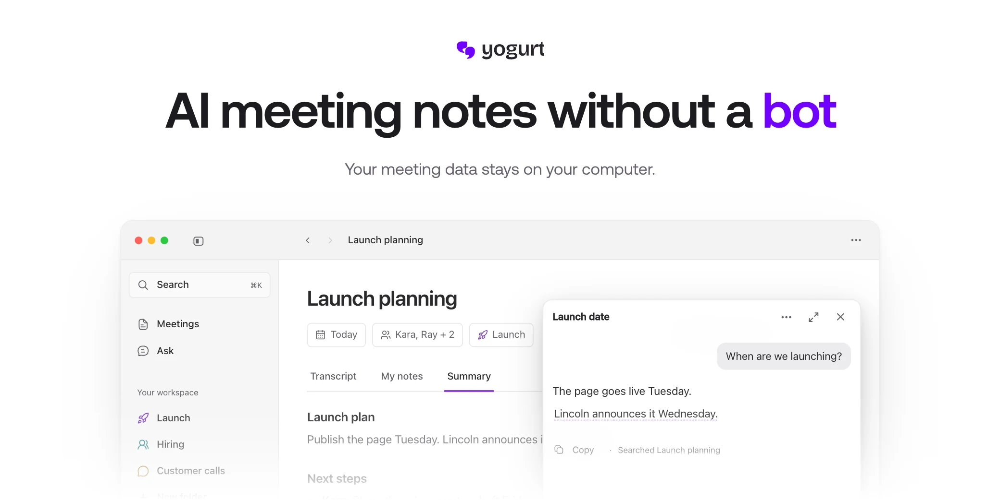

<h1 align="center">Cakapp</h1>

<a href="https://maxy.academy"><picture><source media="(prefers-color-scheme: dark)" srcset="docs/assets/readme-banner-app-dark.webp"></picture></a>

Cakapp AI Note Taker. Private meeting notes, with no bot in your call.

 

<a href="https://maxy.academy">Website</a>
 · 
<a href="https://github.com/yudstrz/cakapp">GitHub</a>

## Introduction

Cakapp records your microphone and call audio, then transcribes and summarizes on your Mac, Windows or Linux computer. It names speakers from Zoom, Teams and Meet and answers questions across meetings with sources.

## Why

Our conversations should be our own business. Good notes shouldn't need third-party servers or an account. That's why we built Cakapp to record, transcribe and summarize on your computer. It goes online only to download models and check for updates.

## Download

Cakapp is available for [Mac](https://github.com/yudstrz/cakapp/releases/latest/download/Cakapp-mac-arm64.dmg), [Windows](https://github.com/yudstrz/cakapp/releases/latest/download/Cakapp-windows-x64.exe) and [Linux](https://github.com/yudstrz/cakapp/releases/latest/download/Cakapp-linux-x86_64.AppImage).

## What it does

- **Live transcripts.** Cakapp records calls and turns speech into text as you talk.
- **Meeting summaries.** Cakapp writes up the conversation and any notes you add.
- **Private by default.** Your audio, transcripts and AI processing stay on your computer.
- **Free and open source.** You can use Cakapp without an account.
- **Who said what.** Cakapp names speakers from Zoom, Teams and Meet on Mac, Windows and Linux.
- **Languages.** Multi-language mode transcribes 99 languages, follows each side of the call in its own language, and keeps up when someone switches languages mid-meeting.
- **Recording reminders.** Cakapp offers to record when a supported call starts.
- **Answers with sources.** Cakapp answers questions across meetings and links to the source.
- **Folders and search.** You can find meetings by folder, title, notes or transcript.
- **Copy and export.** You can copy notes or transcripts, or save both as Markdown.
- **Local MCP server.** When you turn this on, apps on your computer can read your notes, transcripts, saved audio and each meeting's calendar details (attendees' names and emails).
- **Automatic stop.** By default, Cakapp stops recording when it detects that your call has ended. A recording you start yourself with New note asks first instead, since it may not be a call.

## How it works

1. **Record.** Start recording your microphone and call audio; you can add your own notes.
2. **Transcribe.** Cakapp uses whisper.cpp and, on supported Macs, Apple SpeechAnalyzer.
3. **Summarize and ask.** A local open-weight model runs through llama.cpp.

Meeting data stays local; Cakapp goes online for model downloads and update checks.

Where your meetings, recordings, settings and models are stored

- Mac uses `~/Library/Application Support/Cakapp`.
- Windows uses `%APPDATA%\Cakapp`.
- Linux uses `~/.config/Cakapp`, or `$XDG_CONFIG_HOME/Cakapp` if set.

## FAQ

<strong>What kind of computer do I need?</strong>

 

> A Mac with Apple silicon and macOS 14.4 or newer, a 64-bit PC with Windows 10 (version 2004) or newer, or a 64-bit Linux computer with Ubuntu 22.04 or newer. Each needs at least 8 GB of memory. If your computer is too slow, Cakapp tells you during setup. On Windows and Linux, you connect your calendar with a private calendar link.

<strong>Does Cakapp join my meetings?</strong>

 

> No. Cakapp records your microphone and the sound playing on your computer. No bot joins the call, so let the other people on the call know you’re recording.

<strong>Are recordings saved?</strong>

 

> Audio is saved by default, and you can turn this off for future meetings in Settings.

<strong>Is Cakapp free?</strong>

 

> Yes. Cakapp is free and open source under the MIT license. No account is needed.

<strong>Does Cakapp work offline?</strong>

 

> Yes. After a one-time download of the AI models, transcription and summaries run locally on your computer.

<strong>Does Cakapp train AI on my meetings? Can anyone at Cakapp read them?</strong>

 

> No. Your recordings, transcripts and notes stay on your computer, and Cakapp has no server that receives them, so nobody at Cakapp can read them. The AI models run on your computer and don't learn from your meetings. Cakapp only goes online to download its models, check for updates and, if you add one, read your calendar link.

<strong>Is Cakapp safe for confidential meetings?</strong>

 

> Cakapp keeps everything on your computer: audio, transcripts and notes are never uploaded, and transcription and summaries run offline. That makes it a good fit for client calls, therapy sessions, legal work and board meetings where audio can't go to a cloud service. You can also turn off saving audio in **Settings**, and Cakapp is open source, so anyone can check what it does. Follow your own rules on getting consent to record.

<strong>How much memory do I need?</strong>

 

> At least 8 GB. Cakapp checks your computer during setup and picks the best transcription and notes models it can run well. With 16 GB or more, Cakapp can usually run a larger notes model that writes better notes.

<strong>Can I turn an existing recording into notes?</strong>

 

> Yes. Use **Upload a file** to add an MP3, M4A or WAV recording. Cakapp transcribes it on your computer and writes notes, the same as for a live meeting.

<strong>Can I ask questions across all my meetings?</strong>

 

> Yes. Use **Ask** to ask about one meeting, a folder, or all your meetings at once, for example "what did we decide about pricing?". Answers point to the meetings they came from, and everything runs on your computer.

<strong>How accurate is it compared to cloud transcription?</strong>

 

> Cakapp uses Whisper large-v3-turbo on computers that can run it, the same family of models many cloud services use, so English accuracy is close to cloud transcription. Smaller computers get a smaller Whisper model, which is faster but makes more mistakes, especially outside English. You can add names and words to a custom vocabulary so they're spelled right.

<strong>How much does setup download?</strong>

 

> It depends on your computer. Cakapp sets up transcription first, then downloads the notes models selected for your computer. Recording works once setup finishes, and notes and questions work offline once the notes model is in.

<strong>How do I connect my assistant app?</strong>

 

> In **Settings → AI apps**, turn on access, copy the helper command, and add it as a local MCP server in your assistant app. Access is off by default. The app can read your meetings (including their calendar details: the event, and attendees' names and emails), notes and transcripts, but cannot change them. It may send what it reads to its own online model. Turn access off in Cakapp to stop further reads.

<strong>Can other apps read my notes through MCP?</strong>

 

> Access is off until you enable it in **Settings → AI apps**. Apps get read-only access to meetings (with their calendar event and attendees' names and emails), notes and transcripts. Mac and Linux use a socket in your profile folder with `0600` permissions, so only your user account can open it. Windows uses a named pipe with a new random name each launch, stored only in your profile folder. There is no per-app token, so any app running under your account can read while access is on. Settings shows connected apps by their self-reported names.

<strong>Which AI models does Cakapp use?</strong>

 

> Transcription uses Whisper through whisper.cpp, with large-v3-turbo or a smaller model depending on your computer. On supported Macs, Apple SpeechAnalyzer supplies live words while Whisper produces the saved transcript. Summaries and answers use a local open-weight model from the Gemma 4, gpt-oss or Qwen3 families, chosen for your hardware and run through llama.cpp. The app uses Electron and needs no account.

<strong>Which languages does Cakapp support?</strong>

 

> Pick **Multi-language** in **Settings → Language → Spoken language** to transcribe 99 languages. You can also switch from the **English** menu in a note’s footer before or during recording. English only is the default, and it’s the fastest and most accurate choice for English meetings.
>
> In Multi-language mode, you and the other side of the call can each speak your own language, and Cakapp follows along when someone switches languages mid-meeting. Summaries follow the meeting’s main language, or the one you pick in **Settings → Summary language**. Answers in Ask follow your question’s language. Settings also offers 32 app languages.

<strong>Which call apps does Cakapp work with?</strong>

 

> You can record calls in any app because Cakapp captures your microphone and system audio. Call detection covers Zoom, Teams and Meet. On Mac, Cakapp can also read their speaker names with Accessibility permission, when the call app shows who is speaking.

<strong>How does Cakapp know a call has started?</strong>

 

> It checks which apps are using your microphone. For browser calls, it also checks the tab title or a nearby calendar event with a call link. This triggers an offer to record; recording starts only when you choose to.

<strong>How do I connect my calendar?</strong>

 

> On Mac, allow Calendar access in Settings. Cakapp reads the calendars already on your computer and lets you choose which ones to show. You do not sign into a calendar account in Cakapp.

## Support

- [Help](docs/README.md)
- [Report a bug](https://github.com/yudstrz/cakapp/issues)

## Development

- [Build and run locally](docs/building.md)

---

Made by [Maxy Academy](https://maxy.academy), [MIT license](LICENSE).
